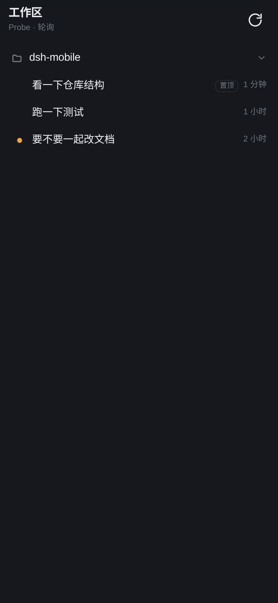
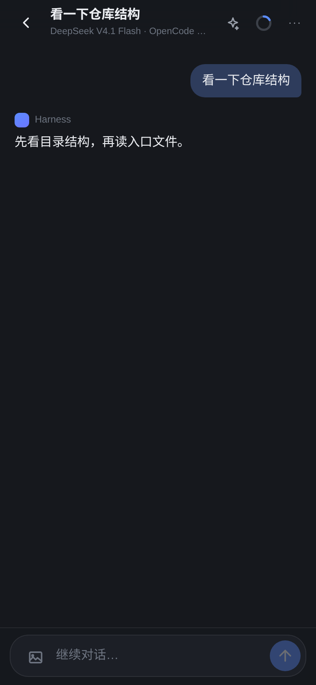
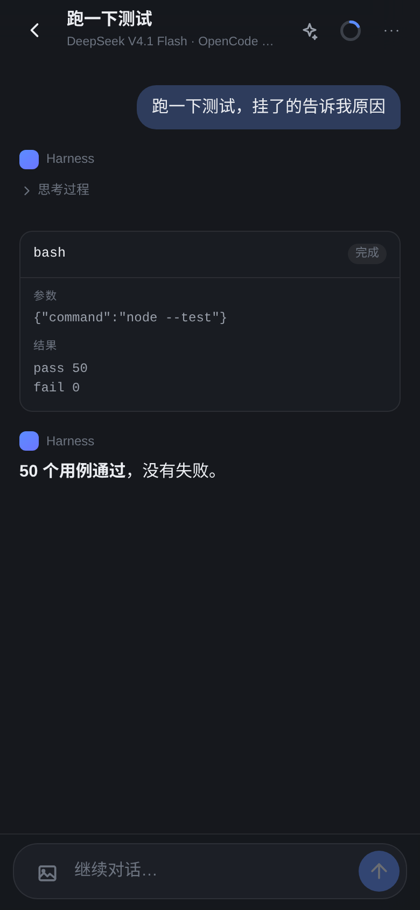
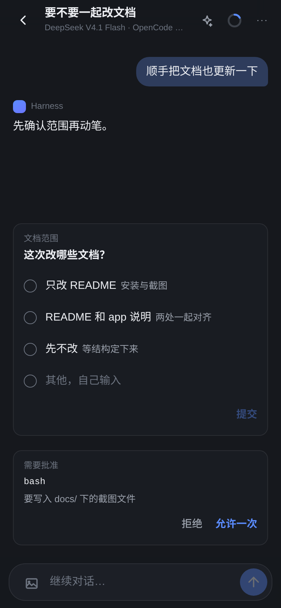
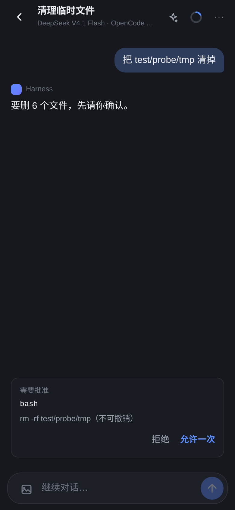
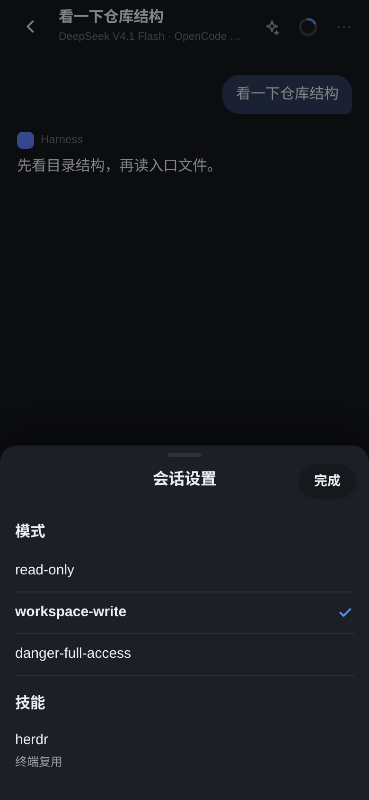
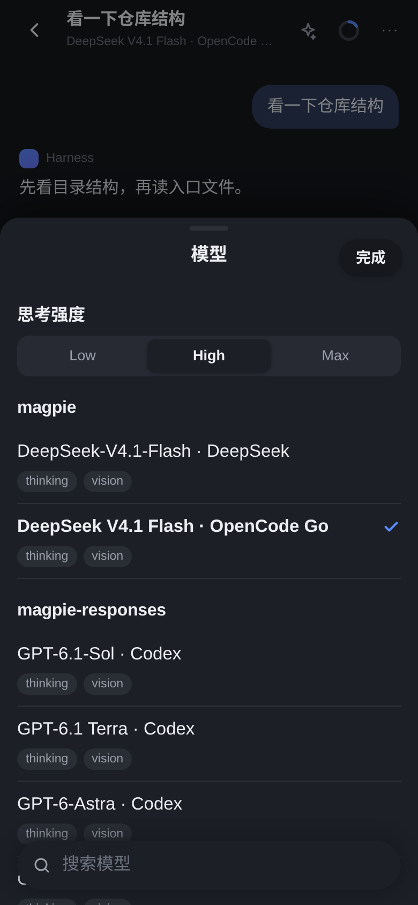
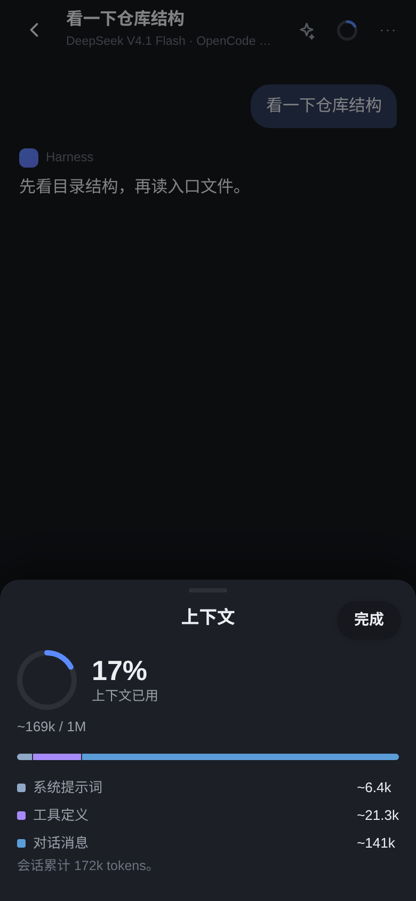
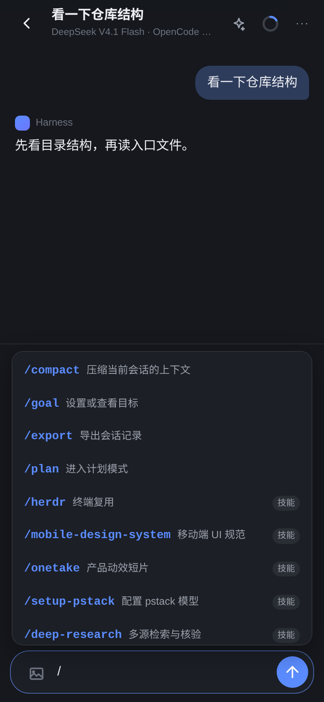

# dsh-pair — pair a phone with DeepSeek Harness by QR

[](https://github.com/Dy1an5/dsh-pair/actions/workflows/ci.yml)
[](https://www.npmjs.com/package/dsh-pair)

**English** | [中文](README.zh.md)

A phone channel for DeepSeek Harness: the desktop shows a QR code, the phone scans it and
joins the same Harness over the LAN — browse workspaces and sessions, open history, keep
chatting.

## Why this one

- **Pairing takes ten seconds.** The desktop renders a QR; scanning it *is* the setup. No app
  to install, no account, no port forwarding, no DNS.
- **Many devices at once.** Up to eight phones or tablets each hold their own `HttpOnly`
  cookie while the desktop keeps working — both sides see the same session, and whoever
  answers first wins.
- **Not a read-only mirror.** Session tree, history, live streaming, sending prompts,
  stopping a turn, answering approvals and questions, model and context pickers, slash
  commands, inline images, and a full-screen PWA.
- **Nothing to build.** The phone UI is static files served by the plugin itself; the plugin
  is one Host bundle plus one client page.
- **Bounded on purpose.** One-time token (10 minutes by default), cookie scoped to `/m`,
  devices revocable from the desktop page, LAN-only, and no writes to the session log.

## For an AI agent

If the user asks "can I use this from my phone", this is the whole procedure — no other steps,
no config files to hand-edit:

```bash
dsh plugin --profile web add dsh-pair   # 1. install the bundle
npx dsh-pair-install                    # 2. register it in dsh.profile.bundles
npx dsh-pair-serve --detach             # 3. bind a LAN address, print the pairing URL
```

`--detach` prints the `http://<LAN IP>:<port>/?token=…` URL to open on the phone. Later,
`npx dsh-pair-serve url` prints it again, `status` reports whether the server is up, `logs`
shows the last lines, and `stop` shuts it down. tmux is optional: when it is installed the
launcher uses a session so `attach` works, otherwise it starts a detached process and tracks a
pidfile.

The phone UI lives in [`./app`](./app); the plugin only pairs, bridges the API, and serves
the static page.

<!-- Percent widths, not fixed pixels: three per line on a wide README, and they
     shrink instead of overflowing on a narrow one. -->
<p align="center">
  
  
  
  
  
  
  
  
  
</p>

## What it does

DeepSeek Harness can already serve its Web GUI over a LAN (`dsh web --host <LAN IP>`). What
is missing is "how does a phone get in quickly and safely", and "what does it look like on a
phone". This plugin adds both:

1. **Pairing.** The plugin mints a short-lived token and renders it as a QR code (the Host
   produces the SVG; the desktop page only displays it). Scanning opens
   `http://<LAN IP>:<port>/m/?t=<token>`, the app exchanges the token for an `HttpOnly` device
   cookie, and everything after that authenticates with the cookie alone. The token grants no
   access to `/api` and never enters Harness' own session cookie.
2. **Bridging.** `/m/api/*` exposes only the four things a phone needs — workspace/session
   tree, one session's transcript, send a message, stop the current turn — by calling the
   Host's `sessionQuery` / `sessionController` / `workspaceController` directly, without
   reimplementing any business logic.
3. **Serving the app.** The phone UI in `app/` is served as static files from `config.appDir`.
   No build step.

## Install

**From npm**

```bash
dsh plugin --profile web add dsh-pair   # 1. install the dependency (forwarded to pnpm)
npx dsh-pair-install                          # 2. add the bundle entry
dsh web --host <your LAN IP>                    # 3. restart
```

**From a GitHub release (pinned build, or offline)**

Every release carries the tarball, so a machine without registry access can install the exact
build the tag points at:

```bash
dsh plugin --profile web add ./dsh-pair-<version>.tgz   # same three steps, local file
npx dsh-pair-install
dsh web --host <your LAN IP>
```

Or let the launcher find a reachable address for you — it binds the first LAN address a phone
can actually reach, using the same detection as the plugin (docker / veth / tun addresses are
skipped), and can keep the server in the background:

```bash
npx dsh-pair-serve --detach     # background, prints the pairing URL
npx dsh-pair-serve              # foreground (= dsh web --host <your LAN address>)
npx dsh-pair-serve --port 8321  # extra flags go to `dsh web`
npx dsh-pair-serve --print      # only print the command

npx dsh-pair-serve status       # running? on which address?
npx dsh-pair-serve url          # just the URL (it carries the token)
npx dsh-pair-serve logs         # last 40 log lines
npx dsh-pair-serve stop         # stop what --detach started
```

tmux is not required. With tmux installed, `--detach` starts a session so
`npx dsh-pair-serve attach` works; without it, the launcher spawns a detached process and
records a pidfile, and every subcommand behaves the same.

Anything you would otherwise retype every day lives in `$DSH_HOME/dsh-pair.json`:

```json
{ "port": 8321, "detach": true }
```

With that, plain `dsh-pair-serve` starts in the background on 8321 and prints the pairing URL.
`dsh-pair-serve config` shows the file it reads, and an explicit flag still wins over it.

Step 2 is not optional: `dsh plugin add` only puts the package into `node_modules` and
**never** touches `dsh.profile.bundles`. Without that entry the Loader does not load the
bundle at all. `npx dsh-pair-install` adds it; it notices it already lives inside
`<profile>/node_modules`, so it only rewrites the manifest and creates no symlink.

**From a working copy (development)**

```bash
node install.mjs          # --dry-run to print the plan; --profile for another profile
```

The same script in its other mode: when it finds itself elsewhere it symlinks the directory
into `<profile>/node_modules/<package name>`, records the dependency as `link:…`, and adds the
bundle entry. Neither mode touches `cordis.patch.yml` — the insert comes from this package's
own `dsh.bundle.patch`.

## Before publishing

`npm test` includes a set of **packaging guards** (`test/package.test.js`). They do not test
behaviour; they test that the thing we would publish is complete. They exist for a silent
failure: `files` once omitted `app/`, so a published package shipped without the phone UI and
nothing local noticed, because development links the checkout instead of packing it. The
guards cover:

- `private` is gone (npm refuses private packages) and a `LICENSE` exists
- `app/` and its entry assets are in `files` and really exist on disk
- every file named by `exports` / `bin` would actually be packed
- the YAML behind `dsh.bundle.patch` exists and contains an `insert:`
- `test/` and `docs/` stay out of the tarball; `vendor/` and its `NOTICE.md` go in

Run both before publishing:

```bash
npm test                 # 56 cases
npm pack --dry-run       # the file list that would ship (19 files, ~191 KB)
```

Under a read-only `$HOME`, `npm pack --dry-run` fails because `~/.npm/_cacache` is not
writable; use `npm_config_cache=$PWD/.npm-cache npm pack --dry-run`.

`repository` / `homepage` / `bugs` point at the published repository, and the screenshots above
use absolute `raw.githubusercontent.com` URLs because **npmjs.com does not render relative
images**.

The package name is `dsh-pair`. If you ever rename it, edit that one field and re-run
`node install.mjs`: it drops any stale `link:` dependency that points at this directory or at one
that no longer exists, together with its bundle entry and dangling `node_modules` symlink, so no
unloadable row is left behind.

`dsh.bundle.patch` inserts this row into the web profile:

```yaml
- id: mobile
  name: 'dsh-pair'
  config:
    appDir: ./app               # resolved relative to the plugin directory
    pairTtlMinutes: 10
    cookieDays: 30
    maxDevices: 8
```

After restarting `dsh web`:

1. Confirm it listens on a LAN address, not `127.0.0.1`:

   ```bash
   dsh web --host 192.168.x.x --no-open
   ```

2. Open **手机连接** (Phone connection) in the sidebar and scan the QR with the phone camera.
3. On the phone, "Add to Home Screen" turns it into a full-screen app.

> The QR and the desktop page share the Harness origin. `/dsh-pair/pair.json` goes through
> `connection.admit()`, i.e. it requires the current Harness session cookie — someone else on
> the LAN cannot open that address, so they cannot obtain the token either.

## Releasing

One tag drives the whole release — CI runs the suites, publishes to npm with provenance, and
creates the GitHub release with the tarball attached:

```bash
npm version patch          # or minor / major; commits and tags locally
git push --follow-tags
```

The workflow refuses to publish when the tag and `package.json` version disagree, so bumping the
version is the only thing to remember. It authenticates with the `NPM_TOKEN` repository secret.

Two registry quirks worth knowing: the first publish of a brand-new name is accepted
asynchronously (the CLI prints `+ dsh-pair@x.y.z` before `npm view` can see it), and tokens that
bypass 2FA lose direct publish in January 2027 — at that point switch to trusted publishing
(OIDC) and drop `NODE_AUTH_TOKEN` from the workflow.

## Configuration

| Field | Default | Meaning |
|---|---|---|
| `appDir` | `./app` | Phone UI directory, relative to the plugin or absolute |
| `pairTtlMinutes` | `10` | Lifetime of a QR token |
| `cookieDays` | `30` | Lifetime of a device cookie |
| `maxDevices` | `8` | Devices that can be paired at once; the oldest is evicted |
| `storePath` | `$DSH_HOME/storages/dsh-pair-devices.json` | Where the device table and signing key live; empty string disables persistence |
| `phoneOnlyMs` | `0` | How long a desktop dialog is held back while someone watches the session; answering on the phone within that window means the desktop never shows it. `0` = both sides appear at once and whoever answers first wins (default) |
| `debug` | `false` | Logs `offered=` / `push pending=` / `transcript pending=` into the `dsh web` log |

## Startup and phone reachability

For a phone to connect, the Host has to listen on a **concrete LAN address**. Without
`--host`, `dsh web` binds `127.0.0.1` (`dsh-web-app/cordis.patch.yml`:
`host: !!js ctx.webStartup.host ?? '127.0.0.1'`). The phone cannot connect, and the QR only
ever encodes `http://127.0.0.1:…`.

A plugin cannot change the binding: the listener is established before `apply()` runs. So the
plugin does the next best thing — **it hands over the command to run**. When the listener is
loopback-only, `/dsh-pair/pair.json` gains two fields:

```json
{ "loopback": true,
  "lanAddresses": ["10.19.104.225"],
  "bindCommand": "dsh web --host 10.19.104.225 --port 8321" }
```

The desktop "phone connection" page renders that line with a copy button. The user pastes it,
restarts once, and the phone reaches the Host. **No script required.**

Address selection matters: `docker0`, `br-*`, `veth`, `tun/utun` and `tailscale` interfaces are
reachable from the Host but never from a phone, so offering one sends the user to an address
that times out. `169.254.*` link-local and `198.18.0.0/15` (the benchmark range Clash/Meta-style
tun drivers use) are filtered out too. The rest is ranked `192.168.*` → `10.*` → others.

`--public-url` does not change the binding, only the advertised address; it suits a reverse
proxy or tunnel (Tailscale, Cloudflare Tunnel), and those still need `--host`.

## Security model

- **LAN only.** The plugin never changes the listening address; `dsh web --host` decides, and
  a loopback bind makes the desktop page warn.
- **Two independent authentications.** The desktop side reuses Harness' browser cookie
  (`connection.admit`); the phone side uses the plugin's own device cookie (HMAC-SHA256,
  `Path=/m`, `HttpOnly`, `SameSite=Lax`).
- **Short-lived, rotatable tokens.** Expired tokens are replaced automatically; "refresh QR"
  on the desktop page invalidates the current one immediately.
- **Revocable devices.** The desktop page lists connected devices; disconnecting one
  invalidates its cookie immediately.
- **Read-only on the Host.** The plugin only calls read APIs on `workspaceRegistry` and never
  writes the workspace index. With no memberships it groups by directory locally
  (`groupedBy: 'cwd'`) and never reorders the desktop session list.
- **No conversation writes.** The plugin never appends a message to a session. When it takes
  over a question or an approval it only hands back the answer the user already gave on the
  phone, to the same pending request — no `user/message` is created and no other session is
  woken.
- **Device persistence.** The signing key and device table are written to
  `$DSH_HOME/storages/dsh-pair-devices.json` (0600), so phones do not re-pair after a
  `dsh web` restart; deleting the file logs everyone out.
- **`/api` is never exposed.** The phone never uses Harness' RPC channel; the bridge only reads
  the tree, reads a transcript, and sends a prompt.

## HTTP contract

The phone app depends only on these endpoints (see [`app/README.md`](./app/README.md)):

| Method | Path | Auth | Purpose |
|---|---|---|---|
| GET | `/m/` | none | Phone app static page |
| GET | `/m/?t=<token>` | none | Opened with a pairing token; the app redeems it for a cookie |
| POST | `/m/api/pair` | token | Exchange for a device cookie |
| POST | `/m/api/unpair` | cookie | Drop this phone's cookie |
| GET | `/m/api/state` | cookie | Workspace + session tree + pending interactions |
| GET | `/m/api/session/:id?after=<seq>` | cookie | Transcript (incremental), with a `live` snapshot |
| GET | `/m/api/session/:id/stream` | cookie | SSE: incremental text of the reply in progress |
| GET | `/m/api/events` | cookie | SSE: realtime push of pending interactions |
| POST | `/m/api/session/:id/prompt` | cookie | Send one message |
| POST | `/m/api/session/:id/cancel` | cookie | Stop the current turn |
| POST | `/m/api/session/:id/approval` | cookie | Allow / deny one tool call |
| POST | `/m/api/session/:id/answer` | cookie | Answer an `ask_user_question` |
| GET | `/m/api/session/:id/meta` | cookie | Models (with the selected one) / modes / commands and skills / context usage and breakdown |
| POST | `/m/api/session/:id/model` | cookie | Switch model |
| POST | `/m/api/session/:id/mode` | cookie | Switch permission mode |
| POST | `/m/api/session/:id/command` | cookie | Run one slash-command line; anything that is not a command is sent as a prompt (this is how skills go) |
| GET | `/m/api/session/:id/image/:attachmentId` | cookie | One image from the session |
| GET | `/dsh-pair/pair.json` | Harness cookie | Desktop QR document (URL, SVG, expiry, device list) |
| POST | `/dsh-pair/revoke.json` | Harness cookie | Revoke one device |

Transcript items carry a stable `key`; a tool call and its result merge by `callId`; `after`
returns only items past the cursor and the app merges incrementally by `key`.

## Development

```bash
node --test test/plugin.test.js
```

The tests boot a real `node:http` server via [`test/harness.js`](./test/harness.js) with the
five Host dependencies replaced (`webServer` / `connection` / `sessionQuery` /
`sessionController` / `workspaceController`), covering routing, cookies, pairing, incremental
reads and prompt sending.

Visual checks live in `test/probe/`: a stub Host plus raw CDP driving headless Chromium at
iPhone size, used to screenshot the real phone UI (development only — not published).

## Images

- **Sending.** `POST /m/api/session/:id/prompt` accepts `{ text, images: [{ mediaType, data }] }`
  with base64 `data`. The plugin feeds them straight into the `PromptContentPart` array of
  `sessionController.prompt`; persistence is the Host attachment service's job. The request
  body is capped at 5 MB (`MAX_PROMPT_BYTES`); the phone downscales to 1280 px on the long edge
  first (an 11 MB original measured ~0.8 MB), and png / jpeg / webp / gif are accepted.
  Rendering mirrors chat convention: **image above, text below**, with the text bubble
  independent of the picture. This requires a model that accepts image input: the Host checks
  `llm.resolveModelInfo(...).inputModalities`, and a text-only model (DeepSeek-V4-Pro) rejects
  the request with `MODEL_DOES_NOT_SUPPORT_IMAGES`, so switch to an image-capable model such as
  `deepseek-flash` (V4.1-Flash) first. `GET /meta` reports `supportsImages`, and the app greys
  out the attachment button accordingly.
- **Viewing.** `image` blocks in user messages, assistant messages and tool results carry
  `images: [{ id, width, height }]`; the app fetches bytes from
  `/m/api/session/:id/image/:id` (via `attachments.imageHostPath()`, falling back to
  re-encoding through `readImageRequest()`). Attachment ids look like `sha256:<hex>` and are
  encoded per path segment — encoding the whole string would let the router eat the `/`.
- **Thumbnails.** 240 px thumbnails in bubbles, assistant replies and tool results; multiple
  images lay out as a two-column grid.
- **Fullscreen.** `object-fit: contain` shows the whole frame (a tall image keeps its bottom);
  tapping toggles 1x / 2.5x, drag pans with bounds, pinch zooms 1x–4x, and the background or the
  `×` closes.
- **Relative-path images.** `` is served by
  `GET /m/api/session/:id/file?path=…`, rooted at the session's working directory, validated
  with `realpath`, image types only, ≤8 MB each.

## Session settings: three screens, one job each

The top-right corner of a session has three compact icon buttons, each opening its own screen
with no duplicated content. The subtitle under the title is the current model name — the same
affordance every chat app has:

| Entry | Screen | Content |
|---|---|---|
| `✧` sparkle | **Model** | Thinking-effort segmented control, models grouped by provider (name + `thinking` / `vision` badges + a check on the right), floating search bar at the bottom |
| Ring | **Context** | Occupancy ring and percentage, `~used / window`, composition bar, plus system prompt / tool definitions / messages |
| `⋯` | **Session settings** | Modes only |

All three buttons are 34×34 compact icons (they used to be a 30 px pill row under the title,
which ate too much space). The ring is a 22 px mini ring showing the ratio; exact numbers live
inside the screen.

The selected row uses **a check mark and no filled background** (matching the reference
design): a blue fill reads as a separate button and repeats what the check already says.
Supporting details:

- **The check is SVG, not the `✓` glyph.** A glyph's weight and baseline vary with the phone's
  font and often sit against the right edge as if clipped; paths render identically everywhere.
- The check aligns to the **name line** (a model row is taller than the text column, so without
  this it floats between the name and the badges).
- The title is centered and `完成` (Done) is a pill; group labels (`magpie` / `思考强度` /
  `模式`) are 16 px bold, matching the reference hierarchy.

If the Host catalog reports no display name for a mode (it falls back to an id such as
`read-only`), the plugin supplies a Chinese label for known built-in presets (只读 / 工作区可写
/ 完全访问 / 自动 / 自定义); a configured name is used as-is.

All three screens share one sheet, and a late `/meta` repaints it in place instead of flashing
back.

**The skill catalog must be resolved per session — never `ctx.get('skills').list()`.**
The desktop's own skill catalog (`sessionSkillCatalog`) resolves the registry like this:

```js
const registry = presets?.serviceFor(live, 'skills') ?? ctx.get('skills')
const list = await registry.list({ cwd, scope: live })
```

Missing either half yields "only the official skills":

- **Registry source**: an agent preset may mount its own `skills` service, and that is the one
  holding the user's skills; the root service often carries only the bundled set.
- **`cwd` / `scope`**: the filesystem provider scans project roots (`.dsh/skills`,
  `.agents/skills`) only when `cwd` is passed, and agent-scoped layers are visible only through
  `scope`.

The plugin now mirrors that resolution and logs one line whenever the count changes:
`dsh-pair: meta skills=N/M cwd=… preset=true|false` — read that before guessing.

The `thinking` / `vision` badges come from `resolveModelInfo` and the catalog's
`inputModalities`. The former must be asked per model — in this Host it is a synchronous config
read wrapped in a promise, so asking about every model in one `/meta` is acceptable; a
network-backed adapter should cache.

The search field at the bottom is a `position: sticky` bar floating over the list, matching a
name, provider or id. It clears when the sheet closes and survives an in-place repaint (after
switching model or effort).

**Thinking effort** only means anything for the current route, so it is a segmented control at
the top of the model screen (Low / High / Max in the order the Host returns). Tapping one
re-sends `/model` with the same `provider + model`:

```json
POST /m/api/session/:id/model
{ "provider": "magpie", "model": "opencode-go/deepseek-v4.1-flash", "reasoningEffort": "max" }
```

Worth knowing:

- **`llm.listModels()` carries no reasoning efforts**; only
  `llm.resolveModelInfo(provider, model)` returns `reasoning.efforts` / `defaultEffort`. The
  plugin therefore resolves only the current route and keeps cheap catalog data for the rest —
  otherwise every visit to the model screen would interrogate every route.
- The current value prefers the selection's own `reasoningEffort` (`pending ?? lastUsed`) and
  falls back to the Host's `defaultEffort`, so the control stays on what you just picked even
  before the next message.
- Fewer than two options hides the control: one option is not a choice and a lone button looks
  broken.
- A Host rejection (`UNSUPPORTED_REASONING_EFFORT`) surfaces as a toast and never silently
  changes the setting.

`GET /m/api/session/:id/meta` returns five blocks, all from existing Host services:

| Block | Source |
|---|---|
| Model | `llm.listProviders()` + `llm.listModels()`; the current one from the `modelSelection` projection's `pending ?? lastUsed`, then `agentDefaultModel.currentSelection()`, then `request/header` in the session log |
| Mode | `permissionPresets.catalog()` / `current(session)` |
| Commands | `commands.list(agent)`: name / description / input hint |
| Skills | the agent preset's `skills` service (`agentPresets.serviceFor(agent, 'skills')`) with fallback to the root service; `list({ cwd, scope })`, filtered by `userInvocable` |
| Thinking effort | `llm.resolveModelInfo(current.provider, current.model).reasoning`, current route only |
| Context | the `contextPressure` projection (`pressureTokens` / `surfaceTokens` / `sampledSurfaceTokens` / `contextWindow`) plus the `contextBreakdown` projection's `breakdown`; `tokenMeter.measure()` as a fallback |

The context blocks read the same two projections as the meter at the bottom of the desktop, and
compute the percentage the same way (`min(100, round(used / window * 100))`), so the two agree.

**`stateOf()` returns the projection's raw state, not the client wire view.** The shapes
differ, which cost one subtle bug:

- The breakdown lives at `state.breakdown.{systemTokens,toolsTokens,messageTokens}`; reading
  `state.systemTokens` silently yields `undefined` and the screen reports "no breakdown yet".
- `projectedTokens` is only computed in the wire view (`pressureTokens + surfaceTokens -
  sampledSurfaceTokens`). The plugin must apply the same formula, otherwise it would report
  `pressureTokens` alone and show less than the desktop.

**The current model only gets a check when `provider + model` both resolve.** Two traps, both
hit once:

- The service must be read with `ctx.get('sessionProjections')` — the plugin does not inject it,
  and property access throws; a swallowed `catch` then returns `null` forever, so no row gets a
  check and the chip says "default model".
- Read `pending` (what the next request will use), not just `lastUsed`, or the check stays on
  the old model right after a switch.

Writes go through `sessionController.selectModel()`, `permissionPresets.set()` and
`commands.execute(agent, line, [], signal)`.

## Slash commands and skills

Typing `/` in the composer opens a palette merging commands and skills into one list (skills
carry a "技能" badge), filterable by name. Tapping an entry only **inserts** `/name` (plus a
space for commands that take arguments); the user decides when to send — the same behaviour as
the desktop trigger.

The palette height is **clamped against the visual viewport**, not `vh`: when the phone keyboard
opens, iOS keeps the layout viewport at full height, so a `42vh` list ends up half behind the
keyboard — visible to neither eye nor finger, which is exactly the "list won't scroll" report.
The height is now `min(innerHeight, visualViewport.height) * 42%`, the list itself is
`overflow-y: auto` with `overscroll-behavior: contain` and `touch-action: pan-y` so the gesture
belongs to it and never chains to the page. There is also no item cap any more (a former
`.slice(0, 24)` kept every skill past the twenty-fourth out of the DOM entirely, unreachable by
scrolling).

Sending has a single path, and the Host decides who owns the line:

```
POST /m/api/session/:id/command   { "line": "/compact" }
→ { "ran": "command", "kind": "success", "text": "已压缩" }
→ { "ran": "prompt" }                       # not a registered command: sent as a plain prompt
```

**Easy to get wrong:** skills are not commands in the `commands` registry. `/skill-name` is
ordinary prompt text; `dsh-tool-skill`'s `agent/pre-step` hook recognises the name and injects
the skill body as a `skill-invocation`. So the plugin must "try a command first, otherwise send
a prompt" — treating both as commands silently does nothing. The previous `/skill` route made
exactly that mistake: `commands.execute('/herdr')` always returned `undefined` and tapping had
no effect.

A command's own return text is shown as a green toast (not red — that means an error); skills go
through the prompt path and land in the transcript like any message.

## Answering interactions (approval / question)

The phone does not just show an orange dot; it can answer:

- **Approval.** `approval/request` is a Cordis waterfall; the plugin registers with
  `{ prepend: true }` so it sees the request first and then runs the desktop chain in parallel.
  While the phone has the session open, the bottom of the session shows a "需要批准" card (tool
  name + reason + allow-once / deny). Tapping hands `allowed-once` / `rejected` back to the
  waiting tool; with no answer it fails closed after 180 s per desktop semantics.
- **Questions.** `user-questions/request` works the same way. The card renders the question,
  its options (multi-select supported) and free-form input, and returns an
  `AskUserQuestionAnswer`. If the desktop answers first, the phone card disappears on its own.
  Timed questions and blocking questions without a `wait.callId` are both supported (the plugin
  synthesises an id for the latter).

The phone only gets a say under one condition: **it has that session open** (an SSE connection
for it). Every interaction in any other session stays on the desktop; the plugin neither
participates nor interrupts. As soon as a request appears the Host pushes it over
`/m/api/events` to every app instance (measured 5 ms to the banner), and the home screen shows
an orange "session title · needs approval/answer" banner that leads straight to the card —
without waiting for the 5 s poll.

**Both sides appear at once and whoever answers first wins** (default `phoneOnlyMs: 0`). The
Host writes `approval/asked` before running any answerer, so the desktop dialog and the phone
card are genuinely simultaneous. Then:

- phone answers first → the desktop dialog lives only in the desktop front end and withdraws
  itself once the Host settles;
- desktop answers first → the phone card disappears with the push (see below), leaving no card
  that does nothing when tapped.

**Why the desktop must not "wait half a beat"**: `phoneOnlyMs > 0` holds the desktop chain while
someone watches the session. If the phone cannot actually answer (the approval was settled
elsewhere, or cancelled), the held chain wakes first, concludes "nobody answered", and pushes
again to the phone — so the desktop never shows a dialog while the phone card never goes away.
Hence today:

- the desktop is held only when "the phone really holds an answerable card" (the entry is in
  `pendingInteractions` and the session has an SSE connection); otherwise it appears immediately;
- `phoneOnlyMs: 0` (default) never opens a hold window at all.

**Cleaning up after a desktop answer**: besides its own `next()` result the plugin listens for
`approval/decided` in `session/event`. Whoever settles the approval (desktop, timeout, abort)
removes the card from `pendingInteractions` and pushes to the phone immediately. Phone buttons
disable on tap and still refresh on a 404 (already settled), so a card never lingers as a
dead button.

## Session status

The leading dot mirrors the desktop priority and is absent when idle:

| State | Colour | Rule |
|---|---|---|
| Waiting for approval / answer | orange | `approval/asked` without a matching `approval/decided`, or an `active` entry in the `userQuestions` projection |
| Running | green (breathing) | the live session's last turn has no `turn/end` |
| Finished, unread | blue | last activity is later than both "last viewed this session" and "last opened the app" |

The first two are decided on the Host (live sessions only, 5 s cache); unread is browser-local
state in `localStorage` (`dshPair.viewed` / `dshPair.lastVisit`), cleared when the session
is opened.

## Streaming output

While a model runs, the Host emits `agent/assistant-stream` (start / chunk / end). The plugin
listens, folds it into an in-process live text block, and pushes it over SSE:

```
agent/assistant-stream ──▶ liveStreams(sessionId) ──▶ SSE /m/api/session/:id/stream
                                    └──▶ the poll response's live field (fallback when EventSource is unavailable)
```

- The listener must be registered with `{ global: true }` — agent events dispatch in agent
  scope, so a normal scope never sees them.
- Text, reasoning and tool-call arguments all stream incrementally; the `end` frame clears the
  live block and polling picks up the persisted messages.
- Opening a session sends one `snapshot` frame first, so joining mid-reply still shows what has
  been generated.

## Known limitations

- The live block renders as plain text; Markdown (code fences and so on) appears once the
  message is persisted and the polling version renders it.
- "Last activity" is the newest event per session, cached for 60 s; the first load of an
  extremely long session reads metadata once more.
- Only existing sessions can be continued; creating a session on the phone is not supported yet.
- `lastSeenAt` in the device table is only written on pair/revoke, so after a restart "recently
  active" is judged from the last write.
- **A question card (`ask_user_question`) is collapsed by a projection on the desktop, and the
  plugin cannot dismiss it.** That card follows the `userQuestions` projection's `active` flag,
  and the projection only clears it when a `tool/result` or `user-question-reply` lands in the
  session log. Answering on the phone goes through `/m/api/.../answer`, handing the answer to
  the Host waterfall and **writing nothing to the log** — that is the plugin's hard "no
  conversation writes" constraint. So when the phone answers first the desktop may keep showing
  "waiting for an answer" for tens of seconds, until the agent continues, the tool result lands,
  or the user closes the card. Measured: the task does continue normally after a phone answer;
  the desktop card is merely late and does not change the outcome. Raising `phoneOnlyMs` makes
  the phone hold the request first if that bothers you (see the half-beat problem above).

## Directory

```
dsh-pair/
├── index.js              Host plugin: pairing, bridge, static hosting
├── client.js             Desktop "phone connection" page
├── cordis.patch.yml      The profile insert row
├── install.mjs           Profile wiring (also the dsh-pair-install bin)
├── bin/dsh-pair-serve.mjs  Launcher: binds a LAN address a phone can reach
├── app/                  Phone UI (static, no build step)
├── vendor/qrcode.mjs     QR encoder (MIT, see vendor/NOTICE.md)
├── test/                 node:test suites against a real HTTP server
│   └── probe/            CDP-driven headless Chromium screenshots (dev only, not published)
└── docs/                 Phone screenshots
```
