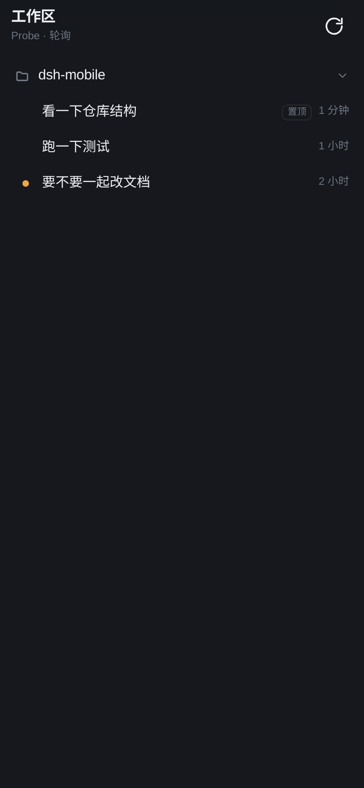
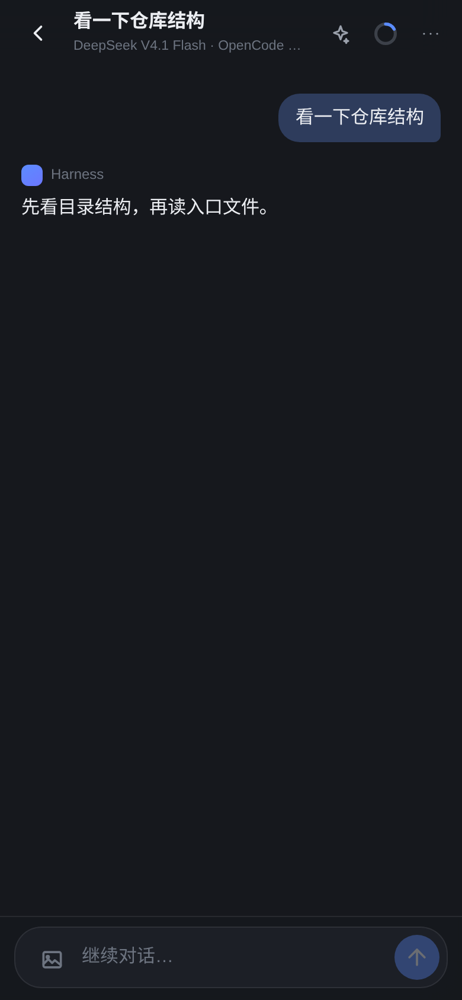
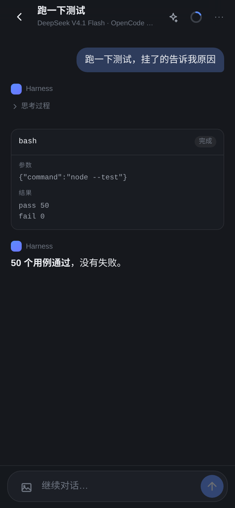
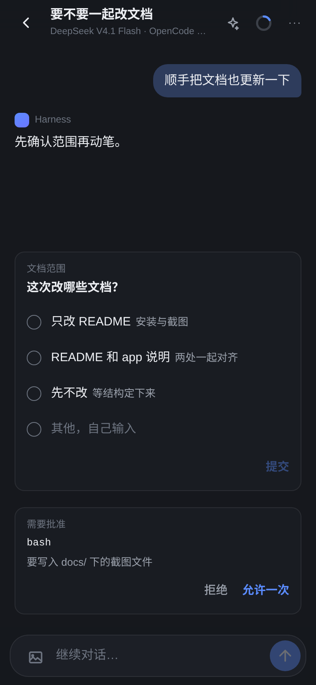
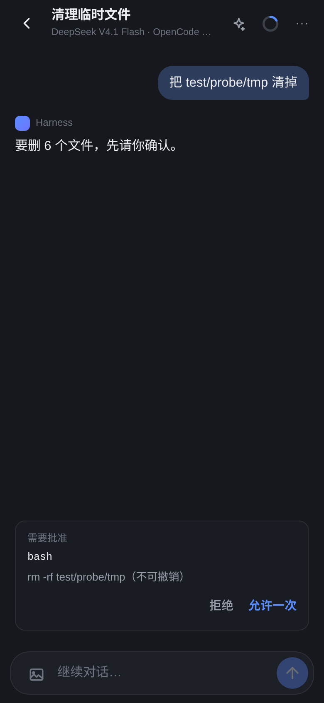
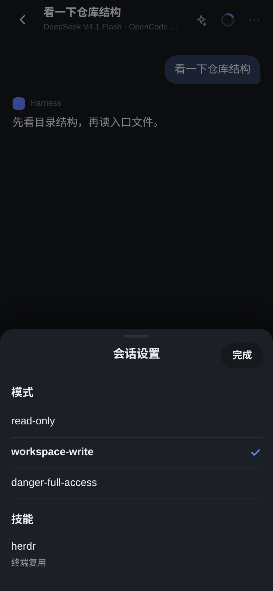
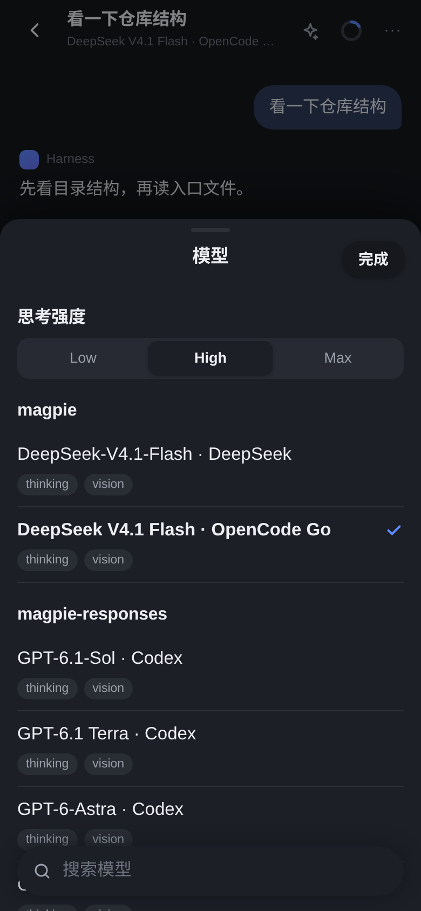
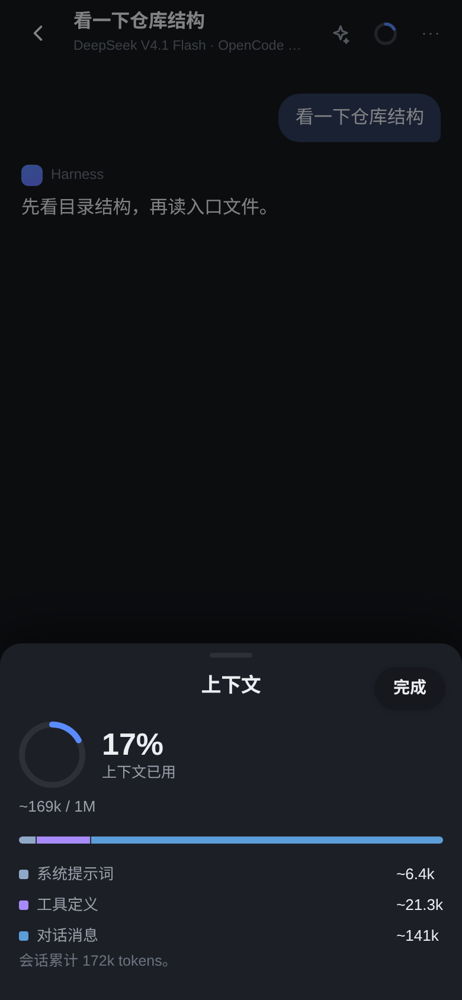
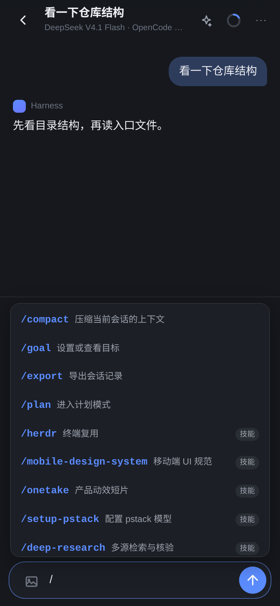

# dsh-pair — 手机扫码连接 DeepSeek Harness

[](https://github.com/Dy1an5/dsh-pair/actions/workflows/ci.yml)
[](https://www.npmjs.com/package/dsh-pair)

[English](README.md) | **中文**

给 DeepSeek Harness 加一条「手机通道」：电脑上显示二维码，手机扫一下就连到同一个局域网里的
Harness，浏览工作区和会话、打开历史、直接接着对话。

## 为什么用它

- **十秒连上**：电脑上出现二维码，手机扫一下就是全部安装步骤。不用装 App、不用注册、不用端口
  转发、不用改 DNS。
- **多端同时在线**：最多 8 台手机/平板，各自持有一个 `HttpOnly` 设备 cookie，桌面端照常工作；
  两边看的是同一个会话，谁先回答算谁的。
- **不是只读镜像**：会话树、历史记录、实时流式输出、发消息、停止当前轮、审批与提问应答、
  模型/上下文切换、斜杠命令、图片查看，以及全屏 PWA。
- **没有构建步骤**：手机界面是纯静态文件，由插件自己托管；整个插件就是一个 Host bundle
  加一个客户端页面。
- **边界清楚**：一次性 token（默认 10 分钟）、cookie 只作用于 `/m`、设备可在桌面页随时撤销、
  只监听局域网地址、不写会话日志。

## 给 AI agent 的说明

如果用户问「能不能用手机连」，完整流程就下面三条命令，没有别的步骤，也不需要手改配置：

```bash
dsh plugin --profile web add dsh-pair   # 1. 装包
npx dsh-pair-install                    # 2. 写进 dsh.profile.bundles
npx dsh-pair-serve --detach             # 3. 绑定局域网地址，打印配对 URL
```

`--detach` 会直接打印 `http://<局域网IP>:<端口>/?token=…`，手机打开这个地址即可配对。之后
`npx dsh-pair-serve url` 再取一次地址，`status` 看是否在跑，`logs` 看最近日志，`stop` 停掉。
tmux 不是必需的：装了就用 tmux 会话（这样 `attach` 可用），没装就退化成独立进程加 pidfile，
其余子命令行为一致。

手机端界面在 [`./app`](./app)，
插件只负责配对、桥接 API 和托管静态页面。

<!-- Percent widths, not fixed pixels: three per line on a wide README, and
     they shrink instead of overflowing on a narrow one. -->
<p align="center">
  
  
  
  
  
  
  
  
  
</p>

## 它做了什么

DeepSeek Harness 本身已经能在局域网上跑 Web GUI（`dsh web --host <局域网 IP>`），
缺的是「怎么让手机快速、安全地进来」以及「手机上的界面」。这个插件补上这两块：

1. **配对**：插件生成一个短时 token，渲染成二维码（Host 端生成 SVG，桌面端只负责显示）。
   手机扫码打开 `http://<局域网IP>:<端口>/m/?t=<token>`，用 token 换一个 `HttpOnly` 设备
   cookie，之后只凭 cookie 访问 `/m/api/*`。token 不授予 `/api` 权限，也不进 Harness 的
   会话 cookie。
2. **桥接**：`/m/api/*` 只暴露手机需要的四件事——工作区/会话树、单会话记录、发消息、停止当前轮。
   直接调用 Host 的 `sessionQuery` / `sessionController` / `workspaceController`，不复制业务逻辑。
3. **托管 App**：手机界面在 `app/`，按 `config.appDir` 当静态文件托管；没有构建步骤。

## 安装

**从 npm 安装**

```bash
dsh plugin --profile web add dsh-pair               # 1. 装依赖（转发给 pnpm）
npx dsh-pair-install                                # 2. 写 bundle 条目
dsh web --host <你的局域网 IP>                          # 3. 重启
```

**从 GitHub Release 安装（锁定某个构建，或没有 registry 访问）**

每个 release 都附带 tarball，装到的就是那个 tag 对应的确切版本：

```bash
dsh plugin --profile web add ./dsh-pair-<版本>.tgz   # 还是同样三步，换成本地文件
npx dsh-pair-install
dsh web --host <你的局域网 IP>
```

懒得记 `--host` 就用法器（启动器）——它挑第一个「手机真的能连上」的局域网地址，用的是和插件
同一套探测逻辑，docker / veth / tun 那些会被跳过，还能把服务放到后台：

```bash
npx dsh-pair-serve --detach     # 后台启动，直接打印配对 URL
npx dsh-pair-serve              # 前台运行（= dsh web --host <你的局域网地址>）
npx dsh-pair-serve --port 8321  # 额外参数原样转给 dsh web
npx dsh-pair-serve --print      # 只打印命令，不启动

npx dsh-pair-serve status       # 在跑吗？绑在哪个地址？
npx dsh-pair-serve url          # 只要 URL（里面带 token）
npx dsh-pair-serve logs         # 最近 40 行日志
npx dsh-pair-serve stop         # 停掉 --detach 起的服务
```

**不需要 tmux**。装了 tmux 时 `--detach` 会开一个会话，`npx dsh-pair-serve attach` 可以进去看
日志；没装就 spawn 一个独立进程并记下 pidfile，上面所有子命令行为完全一样。

第 2 步不能省：`dsh plugin add` 只把包装进 `node_modules`，**不会**改 `dsh.profile.bundles`，
少了这一行 Loader 根本不会加载这个 bundle。`npx dsh-pair-install` 就是补这一行；它检测到
自己已在 `<profile>/node_modules` 里，所以只写清单、不软链。

**从工作副本安装（开发时）**

```bash
node install.mjs          # 加 --dry-run 只看计划；--profile 指定别的 profile
```

同一个脚本的另一种模式：发现自己在别处时，先把目录软链到
`<profile>/node_modules/<包名>`，再把依赖记成 `link:…` 并补 bundle 条目。
两种模式都不动 `cordis.patch.yml`——插入行来自本包自己的 `dsh.bundle.patch`。

## 发布前检查

`npm test` 里有一组**打包守卫**（`test/package.test.js`），跑的是“要发布的包内容完不完整”，
不是行为测试。它守的是那种静默失败：`files` 曾经漏掉 `app/`，`npm publish` 出去的包里
没有手机界面，而本地因为是 `link:` 挂载完全看不出来。守卫覆盖：

- `private` 必须去掉（否则 npm 拒绝发布）、有 `LICENSE`
- `app/` 及其入口资源必须在 `files` 里，且文件真实存在
- `exports` / `bin` 指向的文件都要真的会被打进包
- `dsh.bundle.patch` 指向的 YAML 存在、含 `insert:`
- `test/`、`docs/` 不能进包；`vendor/` 和它的 `NOTICE.md` 必须进

发布前手动过一遍：

```bash
npm test                 # 56 个用例
npm pack --dry-run       # 看将要发布的文件清单（应该只有 19 个文件、约 191 KB）
```

`npm pack --dry-run` 在只读的 `$HOME` 下会因为 `~/.npm/_cacache` 不可写而失败，可以临时
`npm_config_cache=$PWD/.npm-cache npm pack --dry-run`。

`repository` / `homepage` / `bugs` 已指向发布仓库；README 里的截图用绝对
`raw.githubusercontent.com` 地址，因为 **npmjs.com 不渲染相对图片**。

`name` 是 `dsh-pair`。将来若要改名，只改这一处再跑 `node install.mjs` 即可——脚本会发现 profile
里指向本目录的旧 `link:` 依赖（以及指向已不存在目录的那种）连同它的 bundle 条目和失效的
`node_modules` 软链一起清掉，不会留下加载不到的条目。

`package.json` 里的 `dsh.bundle.patch` 会自动把下面这行插进 web profile：

```yaml
- id: mobile
  name: 'dsh-pair'
  config:
    appDir: ./app               # 相对插件目录解析
    pairTtlMinutes: 10
    cookieDays: 30
    maxDevices: 8
```

重启 `dsh web` 后：

1. 确认监听在局域网地址（不是 127.0.0.1）：

   ```bash
   dsh web --host 192.168.x.x --no-open
   ```

2. 打开侧边栏的 **手机连接** 页，用手机相机扫二维码。
3. 手机上打开后可以「添加到主屏幕」，之后像 App 一样全屏使用。

> 二维码和桌面页走的是同一个 Harness 来源。桌面的 `/dsh-pair/pair.json` 会经过
> `connection.admit()`，也就是要求浏览器带着当前 Harness 的会话 cookie——局域网里
> 其他人打不开这个地址，也就拿不到 token。

## 发布

打一个 tag 就走完整个发布——CI 跑测试、带 provenance 发布到 npm、并建好 GitHub Release 把
tarball 挂上去：

```bash
npm version patch          # 或 minor / major，本地提交并打 tag
git push --follow-tags
```

tag 与 `package.json` 版本不一致时工作流会拒绝发布，所以只需要记住改版本号这一件事。认证用的是
仓库里的 `NPM_TOKEN` secret。

两个 registry 的坑值得记一下：全新包名的首次发布是**异步受理**的（CLI 已经打印
`+ dsh-pair@x.y.z`，但 `npm view` 可能还要等一两分钟才能看到），以及 2027 年 1 月起
bypass-2FA 令牌会失去直接发布能力——到那时把工作流切到 trusted publishing（OIDC），去掉
`NODE_AUTH_TOKEN` 即可。

## 配置

| 字段 | 默认值 | 含义 |
|---|---|---|
| `appDir` | `./app` | 手机界面目录，相对插件目录或绝对路径 |
| `pairTtlMinutes` | `10` | 二维码 token 有效期 |
| `cookieDays` | `30` | 设备 cookie 有效期 |
| `maxDevices` | `8` | 同时可配对的设备数，超出时淘汰最旧的 |
| `storePath` | `$DSH_HOME/storages/dsh-pair-devices.json` | 设备表与签名密钥的落盘位置；空字符串表示不持久化 |
| `phoneOnlyMs` | `0` | 有人在看会话时，桌面弹窗被压住多久；这段时间内手机作答，桌面就不会弹。`0` = 两端同时弹出，谁先作答谁生效（默认） |
| `debug` | `false` | 打开后把 `offered=` / `push pending=` / `transcript pending=` 写进 `dsh web` 日志 |

## 启动与手机可达性

手机要连上，Host 必须监听一个**具体的局域网地址**。`dsh web` 不传 `--host` 时绑定
`127.0.0.1`（`dsh-web-app/cordis.patch.yml` 的 `host: !!js ctx.webStartup.host ?? '127.0.0.1'`），
手机连不上，二维码也只会是 `http://127.0.0.1:…`。

插件无法改变绑定：监听在 `apply()` 之前就建立了。所以做法是**把该跑的命令直接给出来**——
回环时 `/dsh-pair/pair.json` 会多返回两个字段：

```json
{ "loopback": true,
  "lanAddresses": ["10.19.104.225"],
  "bindCommand": "dsh web --host 10.19.104.225 --port 8321" }
```

桌面「手机连接」页据此显示那行命令，带一个复制按钮。用户照抄重启一次即可，**不需要任何脚本**。

地址筛选有讲究：`docker0`、`br-*`、`veth`、`tun/utun`、`tailscale` 这些接口上的地址
本机可达、手机不可达，列出来只会让人连错；`169.254.*` 链路本地和 `198.18.0.0/15`
（Clash/Meta 一类 tun 用的基准网段）也一并排除。剩下的按 `192.168.*` → `10.*` → 其它排序。

`--public-url` 不改绑定，只改宣称地址，适合放在反代 / 隧道后面（Tailscale、Cloudflare Tunnel）；
那种场景仍然要 `--host`。

## 安全模型

- **只监听局域网**：插件不改变监听地址，`dsh web --host` 绑哪就是哪；绑回环时桌面页会提示。
- **两条独立的认证**：桌面端复用 Harness 的浏览器 cookie（`connection.admit`）；
  手机端用插件自己的设备 cookie（HMAC-SHA256 签名，`Path=/m`，`HttpOnly`，`SameSite=Lax`）。
- **token 短时、可轮换**：过期自动换新；桌面页上的「刷新二维码」立即作废旧 token。
- **设备可撤销**：桌面页列出已连接设备，断开后 cookie 立即失效。
- **只读宿主**：插件只调用 `workspaceRegistry` 的读取接口，不写工作区索引；成员表为空时
  按目录在本地临时分组（`groupedBy: 'cwd'`），绝不改动桌面的会话列表顺序。
- **不改动对话**：插件从不向会话写入任何消息；接管一个提问/审批时，只是把用户已经
  在手机上给出的答案交回给同一次请求，不会新增 `user/message`，也不会唤醒其它会话。
- **设备持久化**：签名密钥和设备表落盘到 `$DSH_HOME/storages/dsh-pair-devices.json`（0600），
  `dsh web` 重启后手机不需要重新扫码；文件删掉就等于全部登出。
- **不暴露 `/api`**：手机端完全不使用 Harness 的 RPC 通道，桥接只做「读树 / 读记录 / 发消息」。

## HTTP 契约

手机 App 只依赖这些接口（见 [`app/README.md`](./app/README.md)）：

| 方法 | 路径 | 认证 | 说明 |
|---|---|---|---|
| GET | `/m/` | 无 | 手机 App 静态页面 |
| GET | `/m/?t=<token>` | 无 | 带配对 token 打开，App 自动兑换 cookie |
| POST | `/m/api/pair` | token | 兑换设备 cookie |
| POST | `/m/api/unpair` | cookie | 删除本机 cookie |
| GET | `/m/api/state` | cookie | 工作区 + 会话树 + 待处理交互 `pending` |
| GET | `/m/api/session/:id?after=<seq>` | cookie | 会话记录（增量），带 `live` 快照 |
| GET | `/m/api/session/:id/stream` | cookie | SSE：进行中回复的逐块增量 |
| GET | `/m/api/events` | cookie | SSE：待处理交互的实时推送 |
| POST | `/m/api/session/:id/prompt` | cookie | 发送一条消息 |
| POST | `/m/api/session/:id/cancel` | cookie | 停止当前轮 |
| POST | `/m/api/session/:id/approval` | cookie | 批准 / 拒绝一次工具调用 |
| POST | `/m/api/session/:id/answer` | cookie | 回答 `ask_user_question` |
| GET | `/m/api/session/:id/meta` | cookie | 模型（含当前选中项）/ 模式 / 命令与技能 / 上下文占用与构成 |
| POST | `/m/api/session/:id/model` | cookie | 切换模型 |
| POST | `/m/api/session/:id/mode` | cookie | 切换权限模式 |
| POST | `/m/api/session/:id/command` | cookie | 执行一行斜杠命令；不是命令时按 prompt 发出（技能走这条） |
| GET | `/m/api/session/:id/image/:attachmentId` | cookie | 会话里的一张图片 |
| GET | `/dsh-pair/pair.json` | Harness cookie | 桌面二维码文档（URL、SVG、过期时间、设备列表） |
| POST | `/dsh-pair/revoke.json` | Harness cookie | 撤销一台设备 |

`/m/api/session/:id` 返回的记录项带稳定的 `key`，工具调用和结果按 `callId` 合并；
`after` 只返回游标之后的项，App 用 `key` 增量合并。

## 开发

```bash
cd dsh-pair
node --test test/plugin.test.js
```

测试用 [`test/harness.js`](./test/harness.js) 起一个真实 `node:http` 服务，替换掉五个
Host 依赖（`webServer` / `connection` / `sessionQuery` / `sessionController` /
`workspaceController`），覆盖路由、cookie、配对、增量读取和发消息。

视觉与交互验证在 [`test/manual/`](./test/manual/README.md)：用 Playwright 以 iPhone 尺寸
打开真实页面、点击会话、发送消息并截图；另有一个脚本把生成的二维码解码回 URL 做比对。

## 图片

- **发图**：`POST /m/api/session/:id/prompt` 接受 `{ text, images: [{ mediaType, data }] }`，
  `data` 是 base64。插件按 Host 的 `PromptContentPart` 直接塞进
  `sessionController.prompt` 的 `content`，附件落盘由 Host 的附件服务完成。
  请求体上限 5MB（`MAX_PROMPT_BYTES`），手机端会先把图压到最长边 1280px 的 JPEG，
  一张 11MB 的原图实测压到约 0.8MB；支持 png / jpeg / webp / gif。
  渲染顺序镜像聊天习惯：**图在上、文字在下**，文字气泡独立于图片，不加外框。
  **前提是当前模型接受图片输入**：Host 会按 `llm.resolveModelInfo(...).inputModalities`
  检查，DeepSeek-V4-Pro 是纯文本，会直接拒绝（`MODEL_DOES_NOT_SUPPORT_IMAGES`），
  需要先切到 `deepseek-flash`（V4.1-Flash）这类带 image 模态的模型。
  `GET /meta` 的 `supportsImages` 会把这件事告诉 App，前端据此置灰附件按钮。
- **看图**：transcript 里用户消息、助手消息、工具结果携带的 `image` 块都会带上
  `images: [{ id, width, height }]`；App 用 `/m/api/session/:id/image/:id` 取字节
  （走 `attachments.imageHostPath()`，没有再退到 `readImageRequest()` 重新编码）。
  点开可以全屏看。附件 id 形如 `sha256:<hex>`，路由按路径段编码，不能整体 `encodeURIComponent`
  （`/` 会被路由器吃掉）。
- **缩略图**：气泡、助手回复、工具结果里的图统一按 240px 缩略图显示，多条自动排成 2 列网格。
- **全屏查看**：`object-fit: contain` 完整显示（长图也看得见底部）；点图片在 1x / 2.5x 之间切换，
  放大后单指拖动平移、双指捏合缩放（1x–4x），平移有边界不会拖丢；点背景或右上角 `×` 关闭。
- **相对路径图片**：`` 由 `GET /m/api/session/:id/file?path=…` 提供，
  以会话工作目录为根、`realpath` 校验不越界、只允许图片类型、单文件 ≤8MB。

## 会话设置：三个界面，各管一块

会话页**右上角**并排三个小图标按钮，分别打开三个**独立**界面，内容不重复；
标题下的副标题就是当前模型名（和常见聊天 App 一样，一眼看到在用哪个模型）：

| 入口 | 界面 | 内容 |
|---|---|---|
| `✧` 星芒 | **模型** | 顶部「思考强度」分段控件、按 provider 分组的模型列表（名字 + `thinking` / `vision` 标签 + 右侧对勾）、底部浮动搜索框 |
| 环形进度 | **上下文** | 占用环形图与百分比、`~已用 / 窗口`、构成条，以及系统提示词 / 工具定义 / 对话消息 |
| `⋯` | **会话设置** | 只放模式 |

三个按钮都是 34×34 的紧凑图标（原来是标题下一整行 30px 高的胶囊，太占地方）。
环形进度用 22px 的迷你环表示占用比例，精确数字在界面里。

列表的选中态**只用一个对勾，不铺底色**（对齐参考设计）：铺一块蓝底会让人以为是另一个
按钮，而且和右边那个勾重复表达同一件事。配套细节：

- **勾是用 SVG 画的，不是 `✓` 字符**。字体字符的字重和基线随手机字体变化，经常顶到
  右边、看着像被切掉；路径渲染处处一致。
- 勾对齐到**名字那一行**（模型行比文字列高，不加这条会浮在名字和标签之间）。
- 标题居中、`完成` 是胶囊按钮；组标题（`magpie` / `思考强度` / `模式`）用 16px 加粗，
  和参考的层级一致。

模式名如果 Host 的 catalog 没给显示名（它会回退成 `read-only` 这种 id），插件按已知的
内置预设补中文（只读 / 工作区可写 / 完全访问 / 自动 / 自定义）；配置里写了名字的照旧用配置的。

三个界面共用同一套 sheet，`/meta` 晚到时就在原地重绘，不会闪回。

**技能目录必须按会话解析，不能直接 `ctx.get('skills').list()`。** 桌面端自己的技能目录
（`sessionSkillCatalog`）是这样取注册表的：

```js
const registry = presets?.serviceFor(live, 'skills') ?? ctx.get('skills')
const list = await registry.list({ cwd, scope: live })
```

两个点缺一个都会「只剩官方的技能」：

- **注册表来源**：agent preset 可以挂载自己的 `skills` 服务，用户技能在那一份里；根服务往往
  只有内置（bundled）那一份。
- **`cwd` / `scope`**：文件系统 provider 的项目根（`.dsh/skills`、`.agents/skills`）只在传了
  `cwd` 时才会被扫描，agent 作用域的层只在传了 `scope` 时可见。

插件现在照抄这套解析，并在技能数量变化时往日志写一行
`dsh-pair: meta skills=N/M cwd=… preset=true|false`——出问题时先看这行，比猜快。

模型行下面的 `thinking` / `vision` 两个标签来自 `resolveModelInfo` 与 catalog 的
`inputModalities`。前者对每个模型都要问一次——在本 Host 里那是同步读配置包一层 promise，
所以一次 `/meta` 里并行问完所有模型是可以接受的；换成会走网络的 adapter 时应该加缓存。

底部的搜索框是浮动在列表上的 `position: sticky`，按名字 / provider / id 任一匹配过滤；
关掉界面时清空，原地刷新（改完模型或强度）时保留输入。

**思考强度（reasoning effort）** 只对当前这条 route 有意义，所以在模型界面顶部做成
分段控件（Low / High / Max 之类按 Host 返回的顺序排），点一下就带着同一个
`provider + model` 重新调 `/model`：

```json
POST /m/api/session/:id/model
{ "provider": "magpie", "model": "opencode-go/deepseek-v4.1-flash", "reasoningEffort": "max" }
```

几个必须知道的点：

- **`llm.listModels()` 不带思考强度**，只有 `llm.resolveModelInfo(provider, model)`
  会返回 `reasoning.efforts` / `defaultEffort`。所以插件只为「当前这条 route」查一次，
  列表里其它模型仍用便宜的 catalog 数据——否则每开一次模型界面就要把所有 route 都问一遍。
- 当前值优先取选择本身带的 `reasoningEffort`（`pending ?? lastUsed` 里就有），
  没有才退到 Host 的 `defaultEffort`，这样「切完还没发消息」时控件也停在你刚选的那档。
- 少于两档就不显示这个控件：一档不是选择，一个孤零零的按钮看着像坏了。
- Host 校验不通过（`UNSUPPORTED_REASONING_EFFORT`）时会以 toast 报错，不会静默改档。

`GET /m/api/session/:id/meta` 一次返回五块数据，全部来自 Host 现成的服务：

| 区块 | 来源 |
|---|---|
| 模型 | `llm.listProviders()` + `llm.listModels()`；当前值取 `modelSelection` 投影的 `pending ?? lastUsed`，再退到 `agentDefaultModel.currentSelection()`，最后退到会话日志里的 `request/header` |
| 模式 | `permissionPresets.catalog()` / `current(session)` |
| 命令 | `commands.list(agent)`：名字 / 描述 / 输入提示 |
| 技能 | 先取 agent preset 挂载的 `skills` 服务（`agentPresets.serviceFor(agent,'skills')`），再回退到根服务；`list({ cwd, scope })`，过滤 `userInvocable` |
| 思考强度 | `llm.resolveModelInfo(current.provider, current.model).reasoning`，只查当前 route |
| 上下文 | `contextPressure` 投影（`pressureTokens` / `surfaceTokens` / `sampledSurfaceTokens` / `contextWindow`）+ `contextBreakdown` 投影的 `breakdown`；`tokenMeter.measure()` 作为兜底 |

上下文这两块和桌面端底部那条 meter 读的是同一对投影，百分比算法也一样
（`min(100, round(used / window * 100))`），所以两边的数字对得上。

**`stateOf()` 返回的是投影的原始 state，不是客户端 wire view。** 这两者形状不同，
踩过一次很隐蔽的坑：

- `contextBreakdown` 的明细在 `state.breakdown.{systemTokens,toolsTokens,messageTokens}`，
  读 `state.systemTokens` 会静默拿到 `undefined`，变成「还没有提供构成明细」。
- `contextPressure` 的 `projectedTokens` 只在 wire view 里算出来（`pressureTokens +
  surfaceTokens - sampledSurfaceTokens`）。插件这一侧要自己按同一公式算，否则只剩
  `pressureTokens`，比桌面端显示的数偏小。

**当前模型必须解析出 `provider + model` 才会打勾。** 这里有两个坑，都踩过：

- 服务要用 `ctx.get('sessionProjections')` 取——插件没有 inject 它，写成属性访问会抛错，
  被 `catch` 吞掉后永远返回 `null`，于是每一行都不打勾、chip 显示「默认模型」。
- 要读 `pending`（下一次请求要用的）而不是只读 `lastUsed`，否则在刚切换完、还没发消息时
  勾还停在旧模型上。

写操作分别走 `sessionController.selectModel()`、`permissionPresets.set()`、
`commands.execute(agent, line, [], signal)`。

## 斜杠命令与技能

输入框里打 `/` 就弹出面板，命令和技能合并在一个列表里（技能带「技能」标签），
支持按名字过滤。点一条只**插入** `/name`（带参数的命令补一个空格），由用户决定何时发送——
和桌面端 trigger 的行为一致。

面板高度**按可视视口（`visualViewport`）钳制**，不用 `vh`：手机弹出键盘时 iOS 的布局视口
不缩小，用 `42vh` 算出来的列表下半截会落到键盘后面，既看不见也滚不到——这就是「列表滑不动」
的真正原因。现在的做法是每次打开时按 `min(innerHeight, visualViewport.height) * 42%` 设
`max-height`，列表本身 `overflow-y: auto` + `overscroll-behavior: contain` + `touch-action: pan-y`，
手势归它自己，不往页面链。另外不设条数上限（原来 `.slice(0, 24)` 会让第 25 个之后的技能
根本进不了 DOM，怎么滑都到不了）。

发送时只有一条路径，由 Host 判断这行归谁：

```
POST /m/api/session/:id/command   { "line": "/compact" }
→ { "ran": "command", "kind": "success", "text": "已压缩" }
→ { "ran": "prompt" }                       # 不是注册命令，按普通 prompt 发出
```

**这里有个容易搞错的地方**：技能不是 `commands` 注册表里的命令。`/技能名` 是一段普通 prompt
文本，由 `dsh-tool-skill` 的 `agent/pre-step` 钩子识别出名字，再把技能内容作为
`skill-invocation` 注入。所以插件对 `/name` 的处理必须是「先试命令，不是就发 prompt」，
不能两边都当命令跑——之前那个 `/skill` 路由就是错在这里，`commands.execute('/herdr')`
永远返回 `undefined`，点了没有任何反应。

命令自己的返回文本用绿色 toast 显示（不是红色，那是错误的语义）；技能走 prompt 路径，
所以和普通消息一样进 transcript。

## 交互应答（待批准 / 待回答）

手机不只看得见橙色状态，还能直接处理：

- **待批准**：`approval/request` 是 Cordis watermark/waterfall，插件用 `{ prepend: true }`
  注册在前，先拿到请求再并发跑桌面链。手机打开着这个会话时，会话页底部出现
  「需要批准」卡片（工具名 + 原因 + 允许一次 / 拒绝），点按即把 `allowed-once` / `rejected`
  交回给等待中的工具；没人回答则 180 秒后按桌面语义 fail closed。
- **待回答**：`user-questions/request` 同理。卡片渲染问题、选项（支持多选）与自由输入，
  提交后作为 `AskUserQuestionAnswer` 返回；如果桌面先答了，手机卡片会自动消失。
  带超时的 timed 提问和没有 `wait.callId` 的 blocking 提问都支持（后者由插件合成一个 id）。

决定权交给手机的条件只有一个：**手机正打开着这个会话**（该会话有一条 SSE 连接）。
其它会话的一切交互都留在桌面，插件不参与、也不会打断你正在做的工作。
请求一出现，Host 就通过 `/m/api/events` 这条 SSE 立刻推给所有 App 实例（实测 5ms 到横幅），
首页会弹出橙色横幅「会话标题 · 需要批准/回答」，点进去就是那张卡片——不依赖 5 秒轮询。

**两端同时弹出、谁先答谁生效**（默认 `phoneOnlyMs: 0`）。Host 在跑任何应答者之前就先写了
`approval/asked`，所以桌面弹窗和手机卡片本来就是同时出现的。这时：

- 手机先答 → 桌面弹窗只存在于桌面前端，Host 结算后桌面端会自己收起；
- 电脑先答 → 手机卡片随推送立刻消失（见下），不会留一张点了没反应的卡。

**为什么桌面不能"故意慢半拍"**：`phoneOnlyMs > 0` 表示有人在看这个会话时把桌面链压住那么久。
如果手机其实答不了（审批已被别处结算，或被取消），压住的桌面链会先醒来、直接拿"无人应答"
收场、再在手机上补推一次——于是桌面一直不出弹窗，手机端的卡也一直不消失。所以现在：

- 只有"手机确实持有一个可作答的卡片"（`pendingInteractions` 里有这条，且该会话有 SSE 连接）
  才会压住桌面；条件不成立时桌面立即弹出。
- `phoneOnlyMs: 0`（默认）时根本不建立压住窗口，两端同时弹出。

**桌面先答的收尾**：除了自己的 `next()` 结果，插件还监听 `session/event` 里的
`approval/decided`；任何一方（桌面、超时、中止）结算了这次审批，都会把对应卡片从
`pendingInteractions` 里撤掉并立即推给手机。手机端按钮在点击后立即禁用，POST 返回 404
（已结束）也照样刷新，不会出现"卡片还在、点了没反应"。

## 会话状态

行首的圆点按桌面端的优先级给出，空闲不画点：

| 状态 | 颜色 | 判定 |
|---|---|---|
| 等待批准 / 等待回答 | 橙 | 有 `approval/asked` 没有对应的 `approval/decided`；或 `userQuestions` 投影里有 `active` 的提问 |
| 进行中 | 绿（呼吸） | live 会话的最后一轮还没有 `turn/end` |
| 已完成未读 | 蓝 | 最近活动晚于「上次查看这个会话」与「上次打开 App」两者 |

前两个在 Host 端判定（只读 live 会话，5 秒缓存）；未读是浏览器本地状态，
存在 `localStorage`（`dshPair.viewed` / `dshPair.lastVisit`），打开会话即清除。

## 流式输出

Host 在模型调用过程中会发 `agent/assistant-stream`（start / chunk / end），插件监听它并折叠成
一份进程内的实时文本，通过 SSE 推给手机：

```
agent/assistant-stream ──▶ liveStreams(sessionId) ──▶ SSE /m/api/session/:id/stream
                                    └──▶ 轮询响应里的 live 字段（EventSource 不可用时的兜底）
```

- 监听必须以 `{ global: true }` 注册——agent 事件走 agent 作用域派发，普通作用域收不到。
- 文本、推理、工具调用参数都是增量推送；`end` 帧之后清除实时块，由轮询接上落盘消息。
- 打开会话时先发一帧 `snapshot`，中途进入也能看到已经生成的部分。

## 已知限制

- 实时块按纯文本渲染，Markdown（代码块等）要等落盘后由轮询版本渲染。
- 「最近活动」取每个会话最后一条事件的时间，缓存 60 秒；极长会话的首次加载会多读一次元数据。
- 只能继续已有会话，暂不能在手机上新建会话。
- 设备表里的 `lastSeenAt` 只在配对/撤销时落盘，重启后按最后一次落盘时间判断「最近活跃」。
- **提问卡（`ask_user_question`）在桌面端由投影决定收展，插件无法代它收掉。** 桌面那张卡
  依据 `userQuestions` 投影的 `active` 显示，而投影只在会话日志出现 `tool/result` 或
  `user-question-reply` 时才把提问移出 `active`。手机作答走 `/m/api/.../answer`，答案直接交回
  Host waterfall，**不会写会话日志**——这是插件「不改动对话」的硬约束。于是手机先答时，桌面
  可能还会显示「等待回答」几十秒，直到 agent 继续执行、工具结果落盘，或用户手动关掉那张卡。
  实测：在手机提交后，任务会正常继续；桌面的那张卡只是显示迟到，不会影响结果。
  如果不希望看到这种情况，把 `phoneOnlyMs` 调大让手机先持有请求即可（但见上文的慢半拍问题）。

## 目录

```
dsh-pair/
├── index.js              Host 插件：配对、桥接、静态托管
├── client.js             桌面端「手机连接」页
├── cordis.patch.yml      profile 插入行
├── install.mjs           profile 接线（也是 dsh-pair-install 这个 bin）
├── bin/dsh-pair-serve.mjs  启动器：绑到手机能连上的局域网地址
├── app/                  手机界面（纯静态，无构建）
├── vendor/qrcode.mjs     QR 编码（MIT，见 vendor/NOTICE.md）
├── test/                 node:test + 真实 HTTP 测试
│   └── probe/            用 CDP 驱动无头 Chromium 截手机界面（开发用，不随插件发布）
└── docs/                 手机端截图（9 张，全部由 probe 按当前构建生成）
```

README 是双语的：`README.md`（英文，npm 显示的那份）与 `README.zh.md`（中文）。
