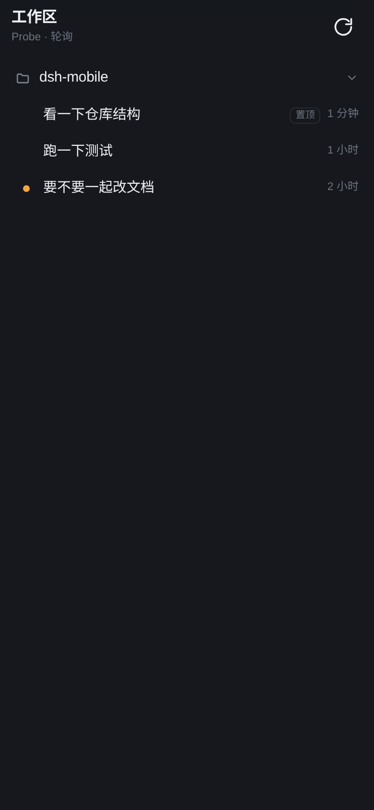
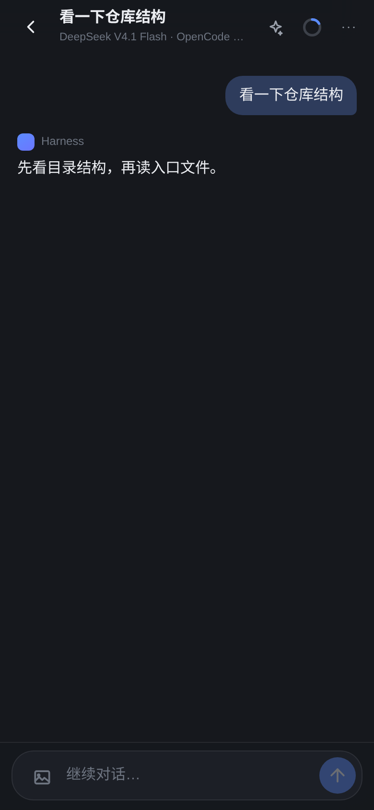
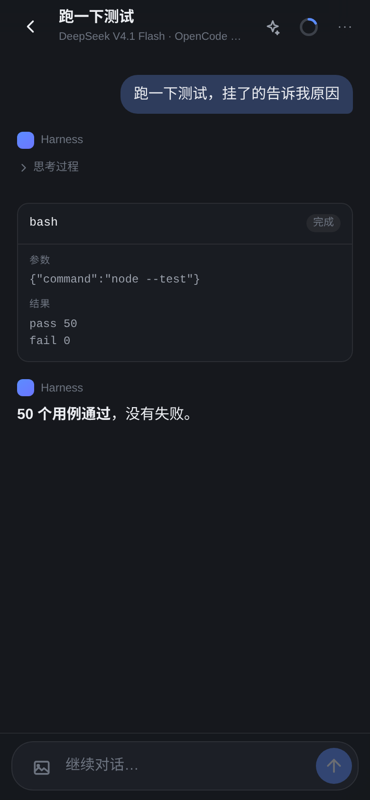

# dsh-pair/app — DeepSeek Harness 手机端

DeepSeek Harness 的手机界面。纯静态：一个 `index.html`、一份 CSS、一份 ES module，
没有构建步骤、没有运行时依赖。

它和上层插件（[`../index.js`](../index.js)）是**两块独立的东西**：插件负责配对与数据桥接，
这个目录只负责屏幕。两者的契约就是下面那组 JSON 接口。这个目录随插件一起发布
（`package.json` 的 `files` 里有 `app/`），由插件按 `config.appDir` 当静态文件托管。

<p align="center">
  
  
  
</p>

## 界面

参考 Alma 的移动端：会话优先、chrome 极薄。

- **列表**：工作区按注册顺序平铺（路径包含关系不产生父子层级），会话缩进在工作区下；
  置顶在前、其余按最近活动排序，行尾显示最近活动时间。行首状态点：橙=等待批准/回答、
  绿（呼吸）=进行中、蓝=已完成未读，空闲不显示；优先级为 等待 > 进行中 > 未读。点工作区行可折叠/展开会话，
  折叠时显示条数；未分组会话单独成组并默认折叠。
- **会话**：用户消息右侧气泡（主题色淡染），助手回复是正文式排版，不套气泡；
  思考过程默认折叠（点「思考过程」展开）；工具调用是一行可展开的卡片（参数 / 结果 / 失败原因）。
- **图片**：输入框左侧是附件按钮，选中后出现在输入框上方的缩略图条（可逐张删除）；
  发送时压到最长边 1280px 的 JPEG（上限约 4.4MB base64）再连同文本提交。
  会话里的图片显示为 240px 缩略图（多图 2 列网格），点击全屏；本地回显在与日志里的
  用户消息对上后立刻收掉，不会重复显示。会话里的图片在气泡内展示，点开全屏。
- **会话设置**：标题下方一条上下文栏，左边模型名、右边 token 用量；点任一处上滑出
  底部面板（模型 / 模式 / 技能 / 上下文），选择即时生效。
- **交互卡片**：会话底部固定显示「需要批准」（允许一次 / 拒绝）和「需要回答」
  （选项、多选、自由输入），数据来自轮询响应里的 `pending`。停在首页时，
  顶部会出现橙色横幅（`/m/api/events` 实时推送，5 秒轮询只作兜底），点一下直接进对应会话。
- **输入栏**：贴着安全区，`visualViewport` 友好，多行自动增高，`Enter` 发送（Shift+Enter 换行）。
- **主题**：跟随系统深/浅色，`--bg` 等一组变量，同一套类名。
- **PWA**：带 manifest 和图标，可以「添加到主屏幕」全屏使用——这一步也是以后套
  Capacitor/Android 壳的基础（WebView 直接加载同一个 `index.html`）。

## 本地跑

插件默认把这个目录当作 `appDir` 托管在 `http://<电脑IP>:<端口>/m/`，不需要单独起服务。

只调界面时，可以用插件测试里的 harness 起一个假 Host：

```bash
node -e "
import('./test/harness.js').then(async ({startHarness}) => {
  const h = await startHarness({ appDir: 'app' })
  console.log(h.base + '/m/')
})
"
```

（真正的入口仍需要 token 配对；测试 harness 里可以直接读 `/dsh-pair/pair.json` 拿 URL。）

## API 契约

所有接口同源，`/m/api/*` 需要设备 cookie（配对后由浏览器保存）。

### `POST /m/api/pair`

```json
{ "token": "<扫码 URL 里的 t>" }
```

成功：`200 { ok, device }` + `Set-Cookie: dsh_pair=...; Path=/m; HttpOnly; SameSite=Lax`
失败：`403 { error: "invalid-token" }`，`429 { error: "too-many-attempts" }`

### `GET /m/api/state`

```json
{
  "device": { "id": "...", "label": "iPhone · Safari" },
  "workspaces": [
    {
      "id": "ws-...",
      "title": "alma_study",
      "path": "/home/dylan/Projects/idea/dsh_creator/plugins",
      "sessions": [
        {
          "id": "session-...",
          "title": "看一下仓库结构",
          "cwd": "/home/dylan/Projects/idea/dsh_creator/plugins",
          "createdAt": 1793706725183,
          "live": true,
          "pinned": false
        }
      ]
    }
  ],
  "loose": [],
  "archivedCount": 0
}
```

### `GET /m/api/session/:id?after=<seq>`

```json
{
  "id": "session-...",
  "title": "看一下仓库结构",
  "cwd": "...",
  "running": false,
  "lastSeq": 42,
  "items": [
    { "key": "u2", "kind": "user", "seq": 2, "time": 1793706726000, "text": "..." },
    { "key": "a3", "kind": "assistant", "seq": 3, "time": 1793706727000, "text": "...", "reasoning": "..." },
    { "key": "tcall-1", "kind": "tool", "seq": 3, "time": 1793706727000,
      "callId": "call-1", "name": "bash", "args": "{\"command\":\"ls\"}",
      "result": "README.md", "isError": false, "resultSeq": 4 }
  ]
}
```

- 无 `after` 时返回尾部最多 200 条；带 `after` 时只返回 `seq > after` 的项，
  以及结果刚落地的工具项（`resultSeq > after`）。
- 同一会话里 `key` 稳定，App 按 `key` 合并；顺序按 `seq`。
- `running` 由「最后一个 `turn/start` 没有对应 `turn/end`」推导。

### `GET /m/api/events`（SSE）

待处理交互的推送：

```
event: pending
data: {"pending":[{"id":"q:call-…","kind":"question","sessionId":"session-…","callId":"…","questions":[…]}]}
```

连接时先推一次当前快照，之后交互出现/结束各推一次。App 用它即时显示首页横幅和会话卡片。

### `GET /m/api/session/:id/stream`（SSE）

`text/event-stream`，事件名即 `type`：

| event | data | 含义 |
|---|---|---|
| `snapshot` | `{text, reasoning, tools, attemptId}` | 连接时正在进行的内容 |
| `start` | `{attemptId, turn, step}` | 新的一次模型调用 |
| `text` | `{text}` | 正文增量 |
| `reasoning` | `{text}` | 推理增量 |
| `tool` | `{callId, name, args}` | 工具调用参数增量 |
| `end` | `{outcome}` | 本次调用结束，随后由轮询接上落盘消息 |

连接失败不影响使用：App 仍以 1.5s 轮询为准，SSE 只负责让文字先流出来。

### `POST /m/api/session/:id/approval`

```json
{ "id": "ap-…", "decision": "allow" | "deny" }
```

`200 { accepted: true }`；审批已结束时 `404`。

### `POST /m/api/session/:id/answer`

```json
{ "id": "q:call-…", "answers": [{ "id": "q1", "selected": ["方案 B"] }] }
```

`200 { accepted: true }`；回答不完整 `400`。

### `POST /m/api/session/:id/prompt`

```json
{ "text": "继续" }
```

`200 { accepted: true }`；空文本 `400`；会话不可恢复时返回 `5xx` 与错误信息。

### `POST /m/api/session/:id/cancel`

`200 { accepted: true }`。

### `POST /m/api/unpair`

删除本机 cookie：`200 { ok: true }`。

## 目录

```
app/                    （插件目录下）
├── index.html            入口
├── app.js                路由、渲染、轮询、发送
├── styles.css            设计变量 + 全部样式
├── manifest.webmanifest  PWA
├── assets/               图标（SVG + 192/512 PNG，播放器/桌面图标用）
└── README.md
```

## 可选：以后做安卓壳

> 当前默认形态是 **PWA**：手机/平板浏览器打开 →「添加到主屏幕」，全屏、有图标、独立窗口。
> 对「同一局域网里扫码接着聊」这个场景已经够用，不需要 APK，也不需要签名和分发。
> 只有在需要<strong>离线打开</strong>、<strong>推送通知</strong>或<strong>应用商店分发</strong>时，
> 才值得再做一个独立壳项目。

这个目录就是 Capacitor 的 `webDir`：

```bash
npx cap init "Harness" app.example.harness --web-dir .
npx cap add android
npx cap sync
```

需要改的只有一处：壳里没有 `/m/api` 同源路径，需要在 `capacitor.config.json` 里把
`server.url` 指向电脑的 `http://<IP>:<端口>/m/`，或者给 App 加一个「输入配对地址」的入口。
